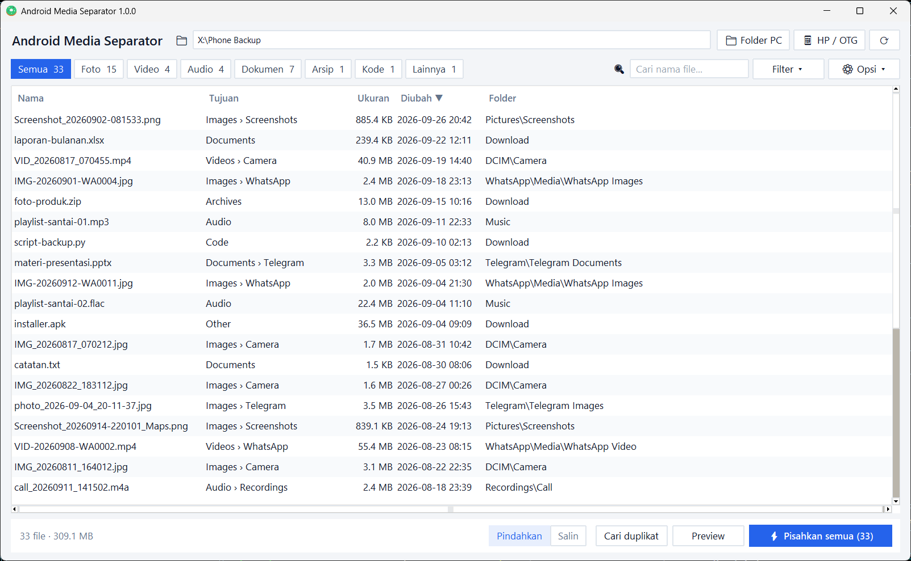
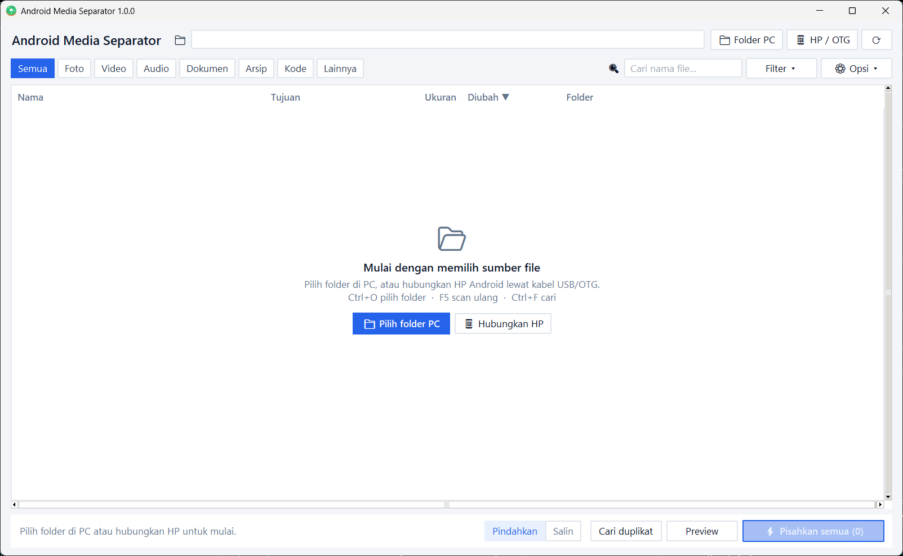
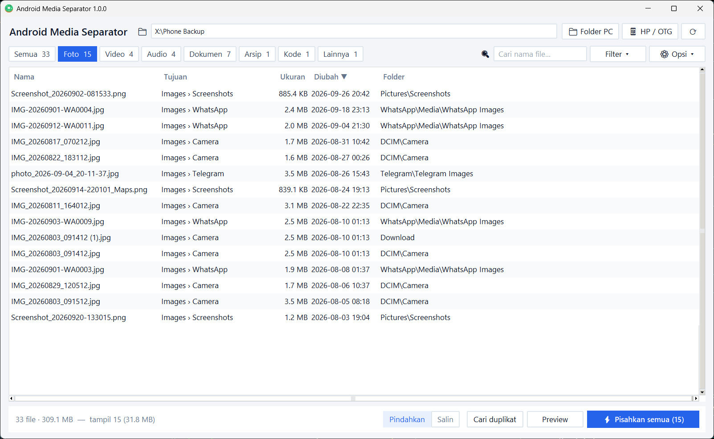
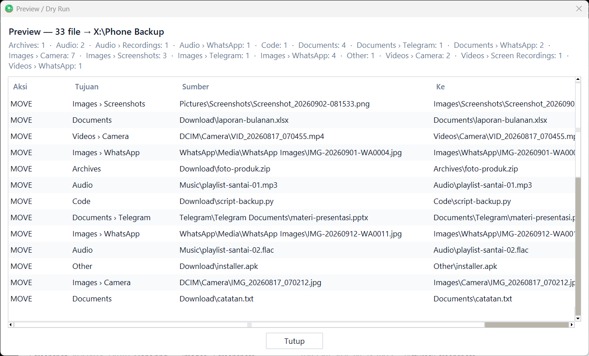
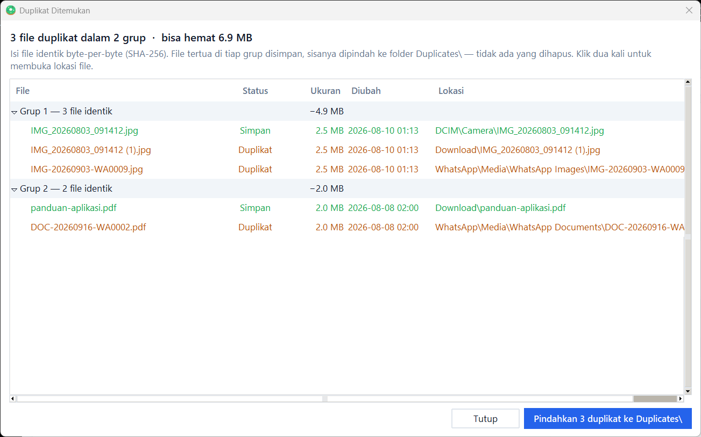

<p align="center">
  
</p>

<h1 align="center">Android Media Separator</h1>

<p align="center">
  Sorts the photos, videos, audio and documents from an Android phone into neat folders on your PC,<br>
  straight over a USB cable or from a folder you already copied.
</p>

<p align="center">
  One Python file · no packages to install · Windows 10/11
</p>



## Features

| Feature | Details |
| --- | --- |
| **Two sources** | A folder on your PC, or an Android phone over USB (MTP) directly. A phone has no drive letter, so the app reaches it through the Windows Shell, the same way Explorer does. |
| **Categories** | Photos, Videos, Audio, Documents, Archives, Code and Other, with 145 known file extensions (RAW/HEIC photos, Office and OpenDocument files, e-books, …). |
| **Android subfolders** | Recognises where a file came from by its name and folder: Camera, Screenshots, Screen Recordings, WhatsApp, Telegram, Instagram and call/voice Recordings. `IMG-20260901-WA0004.jpg` goes to `Images\WhatsApp`, `Screenshot_….png` to `Images\Screenshots`. |
| **Move or copy** | Move to clean up, or copy to leave the source untouched. From a phone, a move deletes each file on the phone only after it has arrived on the PC. |
| **Preview / dry run** | Shows where every file will go before anything is touched. |
| **Name clashes** | Never overwrites by default: `photo.jpg` becomes `photo (1).jpg`. You can choose *skip* or *overwrite* instead. |
| **Duplicate finder** | Compares size, then the first 64 KB, then a full SHA-256 hash, so only truly identical files match. The oldest copy stays; the others move to a `Duplicates` folder. Nothing is deleted. |
| **Protects app data** | WhatsApp backups and databases, encrypted `.crypt` backups, `.db` files and `.nomedia` markers are never moved, so chats can still be restored. Moving WhatsApp media shows a warning and offers to copy instead. |
| **Skips system folders** | `Android/data`, `Android/obb` and hidden folders (`.thumbnails`, …) are left out of the scan. |
| **Filters and search** | Category chips, name search, extensions, size range and date range. Sort by any column. |
| **Exclusions** | Right-click to exclude a file or a whole folder. Exclusions are remembered between runs. |
| **Log** | Every action is written to `_AndroidMediaSeparator_Logs.csv` as it happens, so the log survives even if the PC crashes mid-run. |
| **Stop at any time** | Cancel a long run; files already done stay done. A phone that drops off USB is retried, then reported. |

## Screenshots

| Start | Filter by category |
| --- | --- |
|  |  |

| Preview (dry run) | Duplicates |
| --- | --- |
|  |  |

The interface is in Indonesian.

## Result

The category folders are created inside the source folder, or inside the PC folder you pick when the source is a phone:

```
Phone Backup\
├─ Images\
│  ├─ Camera\
│  ├─ Screenshots\
│  ├─ Telegram\
│  └─ WhatsApp\
├─ Videos\
│  ├─ Camera\
│  ├─ Screen Recordings\
│  └─ WhatsApp\
├─ Audio\
│  ├─ Recordings\
│  └─ WhatsApp\
├─ Documents\
├─ Archives\
├─ Code\
├─ Other\
├─ Duplicates\
└─ _AndroidMediaSeparator_Logs.csv
```

Turn off **Opsi → Subfolder Android** to get only the category folders.

## Usage

You need Windows 10 or 11 and [Python](https://www.python.org/downloads/) (tested on 3.12). Tkinter comes with the standard Windows installer, so there is nothing else to install.

```powershell
pythonw android_media_separator.py   # start the app (no console window)
python android_media_separator.py --self-test
```

**From a PC folder**

1. Click **Folder PC** and choose the folder.
2. Check the table, then press **Preview** to see where each file will go.
3. Choose **Pindahkan** (move) or **Salin** (copy) and press **Pisahkan semua**.

**From a phone**

1. Connect the phone with a USB cable and choose **File transfer** on the phone.
2. Click **HP / OTG** and pick the phone's storage (e.g. *Internal shared storage*).
3. Pick the PC folder to save into, then continue as above. Keep the phone's screen on while it is being read.

To select only some files, select them in the table (<kbd>Ctrl</kbd>/<kbd>Shift</kbd>+click) and right-click → **Pisahkan yang dipilih**.

| Shortcut | Action |
| --- | --- |
| <kbd>Ctrl</kbd>+<kbd>O</kbd> | Choose a PC folder |
| <kbd>F5</kbd> | Scan again |
| <kbd>Ctrl</kbd>+<kbd>F</kbd> | Search |
| <kbd>Ctrl</kbd>+<kbd>A</kbd> | Select all rows |
| Double-click | Show the file in Explorer |

## Settings and files

- **Options** (⚙ Opsi): include subfolders, skip system folders, Android subfolders, protect app data, what to do when a name exists, and manual exclusions.
- **Exclusions** are saved in `%APPDATA%\AndroidMediaSeparator\exclusions.json`. Set `AMS_CONFIG_DIR` to keep them elsewhere.
- **Phone imports** pass through a temporary `.ams_staging` folder inside the destination, which is cleaned up after the run. A file that did not arrive completely stays there and is reported.

## Platform support

| Platform | Status |
| --- | --- |
| Windows 10 / 11 | Supported |
| Linux | Not yet. The sorting engine passes its self-test on Ubuntu 24.04, but phone access (MTP), *show in folder* and *open log* use Windows-only APIs. |
| macOS | Untested |

## License

[MIT](LICENSE) © 2026 Dani Abdani
